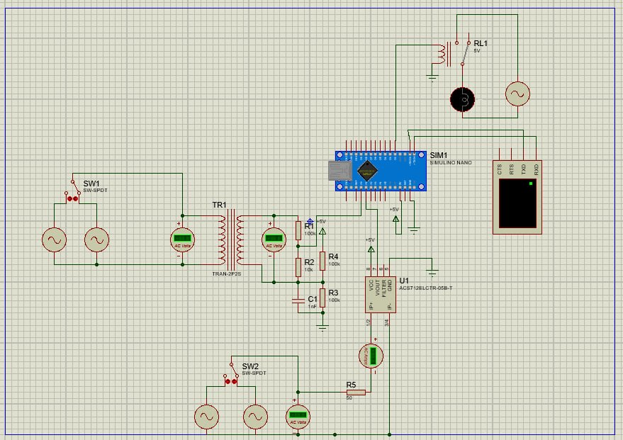

# Voltage protector device

Full design report: [design_document.pdf](design_document.pdf)

## Schematic

Pin diagram (SIMULINO Nano):

- `A0`: scaled AC voltage sample from the TR1 transformer secondary through the R1/R2 divider, biased to mid-rail by R3/R4 and filtered by C1
- `A1`: output of the ACS712-05B current sensor (U1), 185 mV/A, in series with the load path switched by SW2
- `D2`: drives the 5 V relay RL1 that disconnects the appliance
- `D0`/`D1`: UART to the virtual terminal at 9600 8N1
